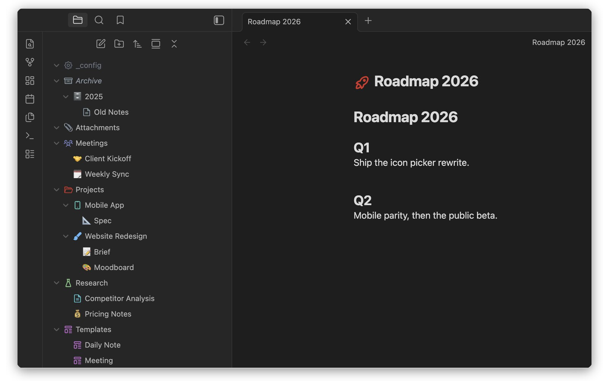
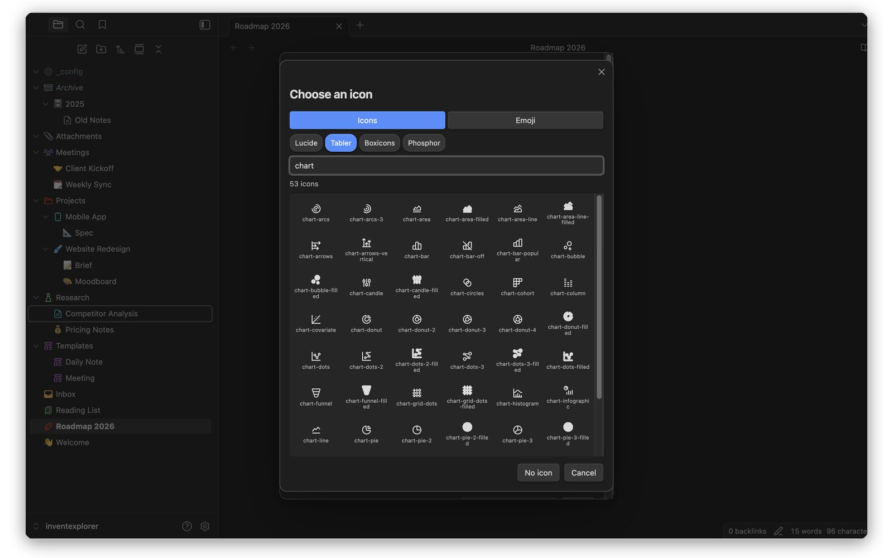
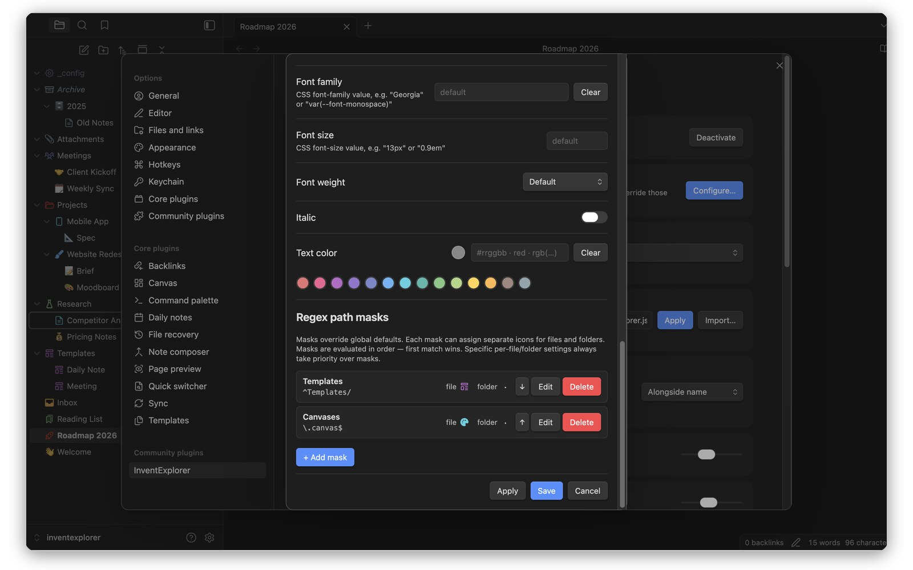
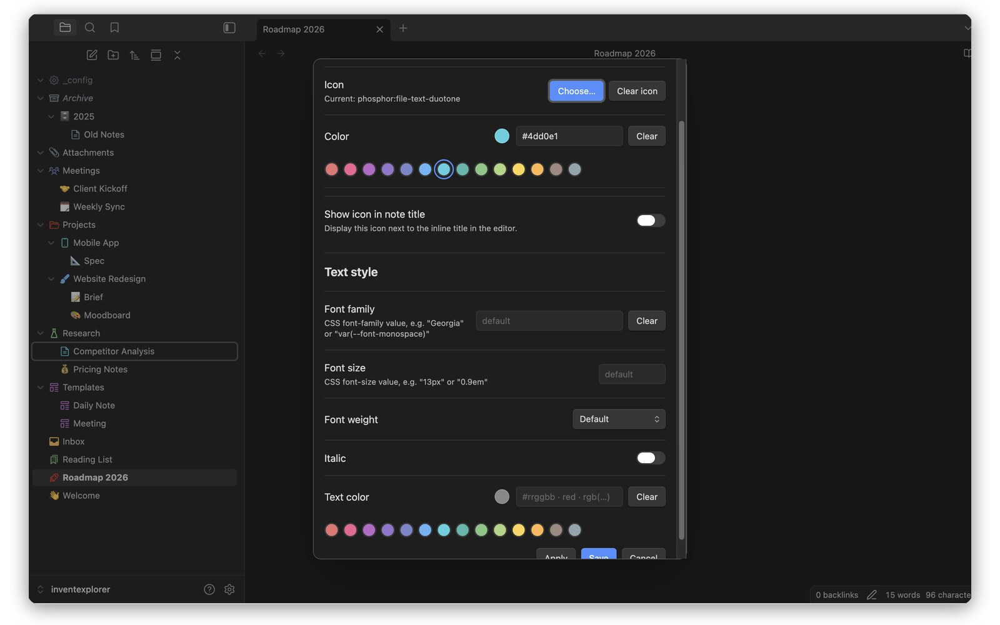

# InventExplorer

Icons, colours and styling for the [Obsidian](https://obsidian.md) file
explorer — per-file and per-folder icons, regex path masks, and thousands of
icons from Lucide, Tabler, Boxicons and Phosphor, plus every emoji.

**Website and documentation: https://inventexplorer.solidinvent.pl**

| Icon picker | Path masks | Text style |
| --- | --- | --- |
|  |  |  |

This repository holds the plugin's source code and its releases. **InventExplorer
is source-available, not open source**: you can read the code, audit what it
does and build it for your own use, under the [EULA](LICENSE). Each release
adds one commit with the source it was built from. The same plugin files are
also available directly from the website.

Building from source: `npm ci && npm run build` produces `main.js`.

## Install

### Manual

1. Download `inventexplorer.zip` from the [latest release](https://github.com/solidinvent-dev/inventexplorer/releases/latest).
2. Unzip it into `<vault>/.obsidian/plugins/` — the archive contains the
   `inventexplorer/` folder.
3. Restart Obsidian, then enable **InventExplorer** under
   Settings → Community plugins.

Installing on mobile? `INSTALL.md` inside the zip covers it.

### With BRAT

[BRAT](https://github.com/TfTHacker/obsidian42-brat) installs the plugin from
this repository and keeps it updated automatically:

1. Install BRAT from Obsidian's community plugins.
2. *Add beta plugin* → `solidinvent-dev/inventexplorer`.

Each release also carries `main.js`, `manifest.json` and `styles.css` as loose
files, which is what BRAT reads.

**About the icon sets.** BRAT only ever fetches those three files, and the icon
sets are 10 MB, so they are not part of a BRAT install. The plugin downloads
whichever set you pick from this release the first time you use it and keeps it
next to `main.js` — the same place the zip would have put it. Lucide and emoji
never depend on that and work regardless.

This makes a BRAT install *smaller* than the zip rather than poorer: it starts
at 255 KB and only fetches the one set you actually chose, where the zip carries
all three whether you want them or not.

## Versions

Every release is tagged and stays available, so you can roll back. The
[latest release](https://github.com/solidinvent-dev/inventexplorer/releases/latest)
is always the current version.

## Free, or one lifetime license

- **Free** — icons on 100 files and folders, Lucide and every emoji, a
  14-colour palette, collapsed/expanded folder icons, one regex path mask.
- **Lifetime license** — one payment, no subscription: unlimited icons and
  masks, the Tabler, Boxicons and Phosphor sets, any CSS colour, global
  defaults, text and explorer styling, on all your vaults and devices.

Prices are on the website.

## Disclosures

- **Payment.** Full capacity requires a lifetime license (one payment, sold
  through Paddle). No account is needed: a license is an email address and a
  key, checked on your device.
- **Network use.** Each connection below happens only in the situation
  described:
  - **Icon set download** — when you first pick an icon from a set that is
    not on disk (a BRAT install ships without them), the plugin downloads that
    set from this repository's release for your version, once, and keeps it
    next to `main.js`.
  - **License standing check** — once a day, only after a license is
    activated, the plugin asks SolidInvent's license endpoint whether the
    license is still valid. It sends the license email encrypted to
    SolidInvent's key and a proof derived from the key, never the key itself
    and never vault content. This is how a refunded or leaked license is
    revoked. Being offline never suspends a license: when you are back
    online, one check runs, however long you were away.
- **Server-side telemetry.** The license endpoint records a SHA-256 hash of
  the license email, the request's IP address and the time, to detect a
  license shared beyond its owner. Nothing else is collected; there is no
  client-side telemetry, analytics or advertising. Details:
  [Privacy Policy](https://inventexplorer.solidinvent.pl/privacy).
- **Files outside the vault.** None.

## Third-party icons

The bundled icon sets are MIT and Apache-2.0 licensed; attribution ships in
`THIRD-PARTY-LICENSES.md` inside the zip and is published on the website.

## Support

Open an issue here, or write to contact@solidinvent.pl.
